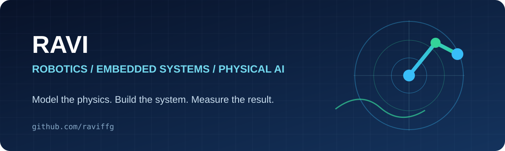
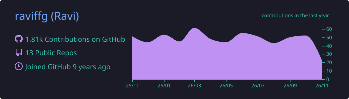
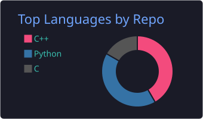
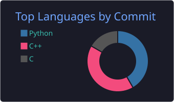
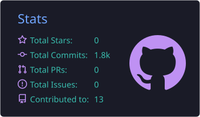
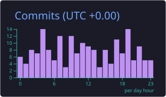
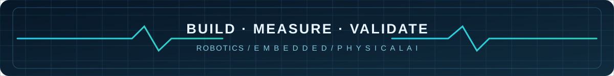

### Robotics • Embedded Systems • Autonomous Navigation • Physical AI

**Engineering-driven software for sensing, motion, control and simulation.**

## About

I'm **Ravi**, exploring practical **robotics, embedded control, autonomous systems, and physics-aware AI evaluation**. My public repositories cover sensor fusion, motion planning, embedded telemetry, manipulation and engineering simulation benchmarks.

I care about interpretable assumptions, reproducible experiments and careful validation. These repositories document engineering experiments, not claims of certified hardware performance or commercial deployment.

## Technology & domains

`Sensor fusion` · `EKF` · `BLDC / FOC` · `SLAM` · `Kinematics` · `RRT` · `FEA` · `CAD evaluation`

## Selected engineering repositories

### Robotics, control & embedded systems

| Project                                                                             | Focus                                                      |
| :---------------------------------------------------------------------------------- | :--------------------------------------------------------- |
| [imu-ekf-attitude](https://github.com/raviffg/imu-ekf-attitude)                     | Inertial attitude estimation and extended Kalman filtering |
| [cnc-backlash-characterizer](https://github.com/raviffg/cnc-backlash-characterizer) | Mechanical backlash measurement and characterization       |
| [bldc-foc-telemetry](https://github.com/raviffg/bldc-foc-telemetry)                 | Brushless DC motor control telemetry                       |
| [bms-thermal-guard](https://github.com/raviffg/bms-thermal-guard)                   | Battery thermal monitoring and protection concepts         |
| [kinematic-4dof-manipulator](https://github.com/raviffg/kinematic-4dof-manipulator) | Four-DOF robot arm kinematics                              |
| [tendon-compliant-gripper](https://github.com/raviffg/tendon-compliant-gripper)     | Tendon-driven compliant gripping                           |
| [rplidar-occupancy-slam](https://github.com/raviffg/rplidar-occupancy-slam)         | LiDAR-based occupancy mapping                              |
| [nonholonomic-rrt-planner](https://github.com/raviffg/nonholonomic-rrt-planner)     | Motion planning with nonholonomic constraints              |

### Physical AI & engineering benchmarks

| Project                                                             | Focus                                             |
| :------------------------------------------------------------------ | :------------------------------------------------ |
| [pcb-physical-bench](https://github.com/raviffg/pcb-physical-bench) | PCB physical constraints and evaluation scenarios |
| [physics-fea-bench](https://github.com/raviffg/physics-fea-bench)   | Finite-element and physics evaluation             |
| [surgical-sim-bench](https://github.com/raviffg/surgical-sim-bench) | Surgical simulation benchmark scenarios           |
| [forge-cad-eval](https://github.com/raviffg/forge-cad-eval)         | CAD evaluation workflows                          |

## GitHub analytics

### Account overview & language breakdown

 

### Contributions over time

### Contribution streak

### Automatically refreshed profile summary cards

<!-- Generated daily by .github/workflows/profile-summary-cards.yml. These images appear after the first successful workflow run. -->

[View GitHub's official contribution calendar](https://github.com/raviffg?tab=overview)

Most cards are produced by independent services; the summary cards above are generated daily by the repository workflow and may be delayed. They appear after the first successful workflow run. Language percentages measure repository code distribution, not personal proficiency. The profile-view counter measures image requests, not unique visitors.

## Connect

Interested in robotics, embedded controls, practical simulation, or reproducible engineering? Explore the [repositories](https://github.com/raviffg?tab=repositories) or [get in touch](mailto:dodik8700@gmail.com).

